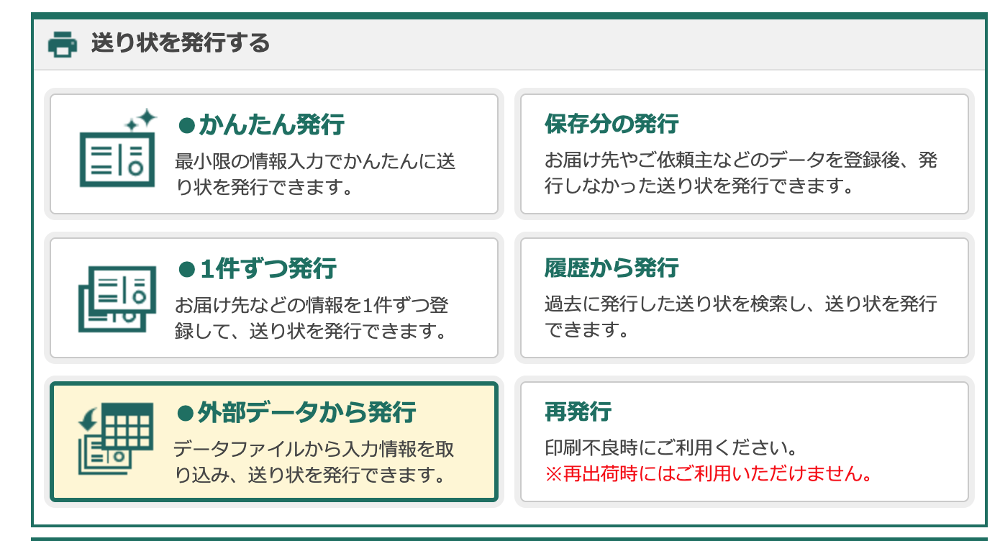
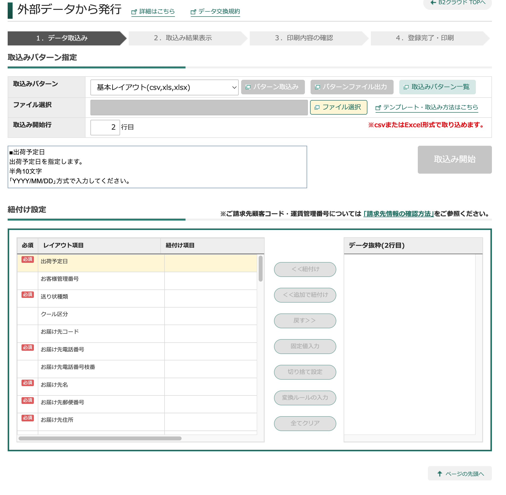

# yamato-b2-csv

**English summary:** Unofficial CLI + Agent Skill that generates shipping-label import CSVs (95-column "basic layout") for **B2 Cloud** (送り状発行システムB2クラウド), the label-issuing system of Yamato Transport (ヤマト運輸, Japan-only service). Use it standalone from the command line, or install it as a skill for Claude Code / OpenClaw / other Agent-Skills-compatible runtimes — ChatGPT users can paste `SKILL.md` as project instructions instead. Documentation below is mainly in Japanese.

---

ヤマト運輸の送り状発行システム「**B2クラウド**」の「外部データから発行(基本レイアウト)」に、そのまま取り込めるCSV(95列)を作るCLIとAIエージェント用スキルです。発送依頼の文面を渡せば、**エージェントが検証済みの取込CSVを作るところまで**自動で行います。





## これは何

- `scripts/generate_csv.py` — 宛先情報を引数に渡すと95列CSVを標準出力へ出力するCLI
- `scripts/verify_csv.py` — 生成CSVの構造(BOM/CRLF/95列/日付形式/ハイフン混入)と、テンプレとの列差分を検証するCLI
- `SKILL.md` — エージェント向けの手順書(テンプレ複製+列差し替え、検証、複数店舗一括、罠集)
- `scripts/auto_import_gui.py` — macOSでB2の取込画面を自動操作する補助スクリプト(任意)

## このツールの位置づけ

- **API契約は不要です。** B2クラウドAPIは法人向けの別サービスで、
  申込み時の商談・審査があり、提供を受けられない場合もあります。
  開発環境から本番環境まで約3か月、料金は1採番あたりの従量課金制です。
  公式: https://business.kuronekoyamato.co.jp/service/lineup/b2api/index.html
  このツールは、B2クラウドの標準機能である「外部データから発行(CSV取込)」を
  使うため、B2クラウドを利用できる状態であれば追加のAPI契約なしで使えます。

- **EC変換ではありません。** 入力元が決まった注文CSVではない発送
  ——メールやチャットで来る発送依頼文、名刺や送付状の宛先など——を、
  AIエージェントが読んで95列CSVに整えるのが主用途です。

- **AIエージェント用スキルとして配布しています。**
  リポジトリ自体が `SKILL.md` を含むスキルディレクトリになっており、
  Claude Code / OpenClaw 等にそのまま配置できます。
  CLIとして単体でも使えます。

- **発行までは自動化しません。** エージェントの完了条件は
  「検証済みCSVの作成まで」です。B2への取込・登録・印刷は、
  内容を人が確認してから行う設計にしています。

### 向いている / 向いていない

向いている:

- 発送件数は少ないが、宛先や品名が毎回違う
- 発送依頼がメール・チャット・文書で届き、転記が発生している
- ECではなく、社内・取引先向けの発送が中心
- API連携ほどの規模ではないが、手入力は減らしたい

向いていない:

- 特定ECの注文を大量に一括発送したい
  → EC変換ツールや受注管理システムの方が適しています
- 送り状番号の取得まで自社システム内で完結させたい
  → B2クラウドAPIの導入を検討してください
- B2クラウド自体を利用できない
  → このツールはCSVを作るだけです。B2クラウドの利用には
    ヤマトビジネスメンバーズと掛売り契約が別途必要です

## セットアップ

```bash
git clone https://github.com/qnosuke/yamato-b2-csv.git
cd yamato-b2-csv
cp config/sender.example.json config/sender.json
```

`config/sender.json` に**自分の値**を入れる(この値がCSVの差出人・請求先ブロックに入る):

| キー | 内容 |
|---|---|
| `sender_tel` | 差出人TEL(ハイフン可) |
| `sender_zip` | 差出人郵便番号(ハイフン可) |
| `sender_addr` | 差出人住所(都道府県から) |
| `sender_addr2` | 差出人建物名(なければ空) |
| `sender_name` | 差出人名 |
| `name_kana` | 差出人略称カナ(半角カナ) |
| `billing_customer_code` | ご請求先顧客コード = B2の請求先設定「コード-分類-運賃管理番号」の**ハイフン前10桁** |
| `billing_class` | 分類コード(ハイフン後が2桁なら空でよい) |
| `freight_manage_no` | 運賃管理番号(ハイフン後2桁。通常 `01`) |

## CLIで使う

```bash
mkdir -p output
python3 scripts/generate_csv.py \
  --dest-name "東京" \
  --dest-company "株式会社サンプル商事" \
  --dest-company2 "営業部" \
  --zip 100-0001 --addr "東京都千代田区千代田1-1-1" \
  --tel 03-0000-0000 --date 2026/12/01 --time am \
  --item "カタログ 30枚" \
  > output/b2csv_20261201_090000.csv

python3 scripts/verify_csv.py output/b2csv_20261201_090000.csv \
  --diff templates/b2_basic_layout_95.csv
```

- 出力はUTF-8(BOM付き)・CRLF・1行目注記行+2行目データ(取込開始行=2)
- `--time am|1416|1618|1820|1921` = 到着時間帯。省略で指定なし
- TEL・〒はハイフン付きで渡してOK(自動で除去)
- 宛名は**姓のみ・敬称なし**(B2側で「様」を付けるため)

## AIエージェントのスキルとして使う

リポジトリのルートがそのままスキルディレクトリです(`SKILL.md` 配置済み)。

- **Claude Code**: `~/.claude/skills/yamato-b2-csv/` にこのリポジトリを clone するだけ。あとは「B2クラウド用の取込CSVを作って」と依頼すればSKILL.mdが発動する
- **OpenClaw**: OpenClawのスキルディレクトリに同様に配置する
- **ChatGPT**: SKILL.mdの中身をプロジェクトのカスタム指示(またはカスタムGPTのInstructions)に貼り、`templates/b2_basic_layout_95.csv` と `config/sender.json` の内容を添付する。「この発送依頼文からSKILL.mdの手順どおりにCSVを作って」と依頼すればCode Interpreterで生成できる

エージェントの完了条件は「CSV作成+検証まで」。**B2への取り込み・発行・集荷依頼は人の作業**としてSKILL.mdに明記してあるので、取込済みと誤認しにくくなっています。

## CSV仕様の要点

- 95列・1行1宛先・UTF-8(BOM付き)・CRLF
- 1行目は「ヘッダー行(B2取込開始行=2のためスキップされます)」という注記行。**触らない**
- よく使う列(1始まり):

| 列 | 項目 | ルール |
|---|---|---|
| 5 / 6 | 出荷予定日 / お届け予定日 | `YYYY/MM/DD` 半角 |
| 7 | 到着時間帯 | 午前=`0812`、他 `1416`/`1618`/`1820`/`1921` |
| 9 | お届け先TEL | ハイフンなし半角。**空欄でも取込可**(実証済み) |
| 11-13 | 〒(ハイフンなし7桁)/住所/建物 | 〒はハイフンを除く |
| 14-16 | 会社・部門1/会社・部門2/宛名 | 宛名は姓のみ・敬称なし。役職宛も16列 |
| 28 | 品名 | 「品名 枚数」形式(例: `カタログ 30枚`) |
| 40-42 | 請求先顧客コード/分類コード/運賃管理番号 | 「`XXXXXXXXXX-01`」型は 40=10桁、41=空、42=`01`(公式FAQ a_id/576) |

公式のデータ交換規約: https://bmypage.kuronekoyamato.co.jp/bmypage/pdf/new_exchange1.pdf
基本レイアウトテンプレート: https://bmypage.kuronekoyamato.co.jp/bmypage/newb2web_template1.xls

## GUI自動取込(macOS のみ・任意)

B2の「外部データから発行」画面を開いた状態で:

```bash
python3 scripts/auto_import_gui.py dry output/b2csv_xxx.csv   # ボタン検出だけ確認
python3 scripts/auto_import_gui.py run output/b2csv_xxx.csv   # ファイル選択〜取込み開始まで
```

- 依存: `pip3 install pillow numpy pyobjc-framework-Quartz`、スクリーン収録の権限
- 起動ブラウザは `B2_BROWSER=Google\ Chrome python3 ...` のように変更可
- ボタン判定画像(`reference/btn_*.jpg`)は特定の解像度で切り出したもの。**ズレる場合は自分の画面からボタン部分を切り出して差し替えてください**
- 安全設計: 「取込み結果表示」で必ず停止する。**登録完了・印刷は押さない**(人が確認してから)

## 免責

- これは非公式の個人製作ツールです。ヤマト運輸様とは関係ありません
- CSVの仕様は変更される可能性があります。公式のデータ交換規約を参照し、**本番取込の前に必ずテスト宛先で1件試してください**
- 発送・請求に関わる操作のため、生成CSVの内容は必ず人が確認すること
- 本ソフトウェアの利用により生じたいかなる損害についても、作者は責任を負いません

## License

[MIT](LICENSE)
